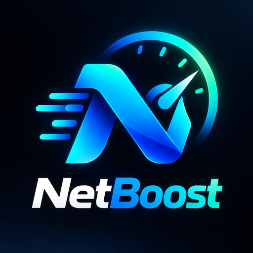

<p align="center">
  
</p>

<h1 align="center">NetBoost</h1>

<p align="center">
  <strong>Intelligent Windows Network Optimization, Bufferbloat Mitigation & Multi-Worker Download Accelerator</strong>
</p>

<p align="center">
  
  
  
  
  
</p>

---

## What is NetBoost?

**NetBoost** is a high-performance Windows desktop application and browser extension engineered to solve network bufferbloat and streaming degradation during heavy downloads.

When downloading large files in standard web browsers, transfers aggressively saturate TCP receive windows and fill network adapter and router queues. This causes network round-trip time (RTT / Ping) and packet jitter to spike dramatically (often from 15ms to over 200ms). Consequently:
- Video playback platforms (YouTube, Netflix, Twitch) drop to low resolutions or freeze to buffer.
- Real-time communication tools (Discord, Zoom, Microsoft Teams) suffer audio stutter, robotic artifacts, or call disconnects.
- Interactive network applications experience latency spikes and packet loss.

NetBoost mitigates this queue collapse by integrating real-time Windows kernel network telemetry, dynamic AIMD read pacing, intelligent media stream detection, and a multi-threaded parallel download accelerator into a unified utility.

---

## How It Works

NetBoost coordinates bandwidth between the Windows network stack and application throughput:

```
+------------------------------------------------------------------------+
|                        NetBoost Architecture                           |
+------------------------------------------------------------------------+
|  Frontend: React 18 + Tailwind CSS + Vite (Desktop GUI)                |
|  Browser:  NetBoost Chrome / Edge Companion Extension (MV3)            |
+---------------------------------+--------------------------------------+
                                  | IPC / Local Loopback REST
+---------------------------------v--------------------------------------+
|                    NetBoost Core Engine (Rust)                         |
+------------------------------------------------------------------------+
| 1. Telemetry Collector (iphlpapi.dll GetIfTable2 64-bit hardware stats)|
| 2. Diagnostics Engine (Active ICMP/UDP RTT, RFC 3550 Interarrival Jitter)|
| 3. Streaming Detector (Inspects active HTTPS sockets & CDN signatures) |
| 4. Bandwidth Coordinator (Adaptive AIMD Pacing & 3-cycle hysteresis)  |
| 5. Segmented Accelerator (Tokio Async Range Workers + Sparse Writes)   |
| 6. DNS Optimizer (UDP Port 53 Benchmark & Windows netsh Automation)    |
| 7. Persistence Layer (SQLite rusqlite for tasks, metrics & benchmarks) |
+------------------------------------------------------------------------+
```

### 1. Hardware Interface Telemetry
NetBoost queries 64-bit hardware interface counters (`InOctets`, `OutOctets`) directly from `iphlpapi.dll` using `GetIfTable2`. It computes network health using an active RFC 3550 interarrival jitter algorithm to detect queue saturation immediately upon onset.

### 2. Streaming Priority & Dynamic Pacing
When **Streaming Priority Mode** is enabled, NetBoost monitors for active media streams (YouTube, Twitch, Netflix, Discord, Zoom, Spotify):
- When link congestion or elevated latency is detected, NetBoost injects an adaptive **20 ms to 30 ms read pacing delay** into download worker chunk loops.
- Worker concurrency is scaled down to **0.50x to 0.60x**.
- This mitigates router queue pressure without terminating background transfers, allowing video streams and voice calls to maintain continuity without buffering.

### 3. Parallel Multi-Worker Download Acceleration
Standard browsers download files sequentially across a single TCP stream:
- NetBoost probes remote servers for HTTP `Range` and `Accept-Ranges` support.
- Files are partitioned into concurrent chunks downloaded simultaneously across **4 to 12 parallel Tokio async workers**.
- Chunks are written directly into pre-allocated sparse `.part` files via seek offsets, eliminating slow post-download merging.
- Verifies payload integrity via automatic SHA-256 hash checks upon completion.

### 4. Browser Download Interception (Chrome & Edge)
With the bundled browser extension:
- Download clicks across websites trigger NetBoost's non-blocking interceptor.
- A quick modal allows users to select **Accelerate with NetBoost** or **Download in Browser** (native "Save As" flow).
- Native browser downloads remain uninterrupted when dismissed.

### 5. Benchmarking & DNS Tuning
- **Benchmark Suite:** Conducts controlled baseline tests (Idle vs Single-Worker vs Multi-Worker vs Streaming Priority) with full comparison history stored in SQLite.
- **DNS Optimization:** Benchmarks Cloudflare (`1.1.1.1`), Google (`8.8.8.8`), Quad9 (`9.9.9.9`), and OpenDNS (`208.67.222.222`) over UDP port 53 sockets, backing up existing adapter configuration before applying the lowest-latency resolver.

---

## Core Features

| Feature | Description |
| :--- | :--- |
| **Streaming Priority** | Dynamically throttles download chunk pacing to safeguard 4K video streams and voice calls. |
| **Multi-Worker Acceleration** | Multi-threaded segmented downloading across configurable worker channels for maximum throughput. |
| **Bufferbloat Mitigation** | Uses RFC 3550 jitter algorithms and 3-cycle hysteresis to prevent Wi-Fi router queue collapse. |
| **DNS Optimizer** | Live UDP port 53 benchmark and automated Windows adapter DNS tuning with backup and restore. |
| **Real-Time Telemetry** | 60-second rolling throughput graph, RTT latency, jitter stability, and packet health index. |
| **Browser Extension** | Captures downloads from Chrome, Edge, and Chromium browsers via local loopback bridge. |
| **Windows Search & Installer** | NSIS installer registers Start Menu shortcuts, Windows Search indexing, and uninstaller. |
| **System Tray Integration** | Minimizes quietly to the Windows system tray with quick-launch and status options. |

---

## Installation & Release Files

### Windows Installer (NSIS Setup)
Download the installer executable from the Releases section:
```
NetBoost_1.0.0_x64-setup.exe
```
- **Windows Search Integration:** Automatically installs to the Windows Start Menu. Press `Win` and type `NetBoost` to launch.
- **Uninstaller:** Registers with Windows *Installed Apps* / *Add or Remove Programs* with an automated uninstaller.
- **User-Level Execution:** Runs in user-mode (`currentUser`) without requiring UAC administrator elevation.

### Standalone Portable Executable
```
NetBoost.exe
```
Single self-contained executable that can be run directly from any folder or removable storage device.

### Browser Extension (Chrome & Edge)

NetBoost includes a companion browser extension for Google Chrome, Microsoft Edge, Brave, and other Chromium browsers that seamlessly connects web downloads to NetBoost's multi-worker engine.

#### Extension Architecture & Security
- **Manifest V3 Compliant:** Engineered according to modern Chrome Extension standards with lightweight service workers and zero background battery drain.
- **Local Loopback Bridge:** Communicates exclusively with the local NetBoost desktop core at `http://127.0.0.1:52140` with zero external analytics, zero tracking, and zero data leaving your machine.
- **Non-Blocking Architecture:** Listens to download creation events synchronously, guaranteeing that if you choose to download normally in your browser, Chrome's native "Save As" prompt and download pipeline operate without freezing or delays.

#### How to Install the Extension
1. Launch NetBoost on your PC.
2. Go to the **Accelerator** tab (or **Settings**) and click **"Open Extension Folder"**. Windows Explorer will automatically open to the installed extension directory.
3. Open your browser and navigate to:
   - Google Chrome: `chrome://extensions`
   - Microsoft Edge: `edge://extensions`
   - Brave: `brave://extensions`
4. Enable **Developer mode** using the toggle switch in the top-right corner.
5. Click **Load unpacked** in the top-left corner and select the extension folder that opened in Step 2.
6. The NetBoost icon will appear in your browser toolbar. When you click download links on websites, NetBoost will automatically detect them and offer accelerated multi-channel downloading.

---

## Building from Source

### Prerequisites
- [Rust & Cargo](https://rustup.rs/) (1.75+ recommended)
- [Node.js](https://nodejs.org/) (v18+ or v20+)
- Windows 10 or 11 with C++ Build Tools installed

### 1. Clone the Repository
```powershell
git clone https://github.com/your-username/NetBoost.git
cd NetBoost
```

### 2. Install Dependencies
```powershell
npm install
```

### 3. Build & Run in Development
```powershell
npm run dev
# In a separate terminal to run the Tauri desktop window:
npm run tauri dev
```

### 4. Build Production Release Executable & Installer
```powershell
npx tauri build --bundles nsis
```
The generated files will be placed in:
- **Installer**: `src-tauri/target/release/bundle/nsis/NetBoost_1.0.0_x64-setup.exe`
- **Standalone Binary**: `src-tauri/target/release/NetBoost.exe`

---

## License

This project is licensed under the [MIT License](LICENSE).
