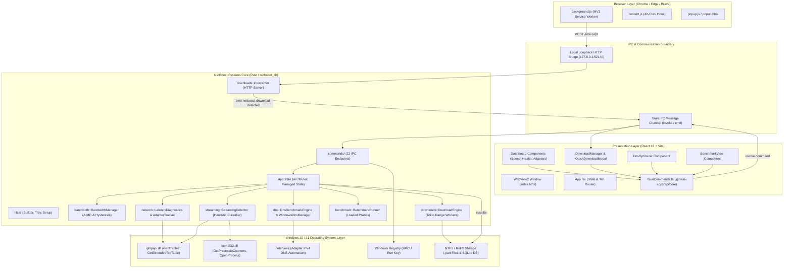
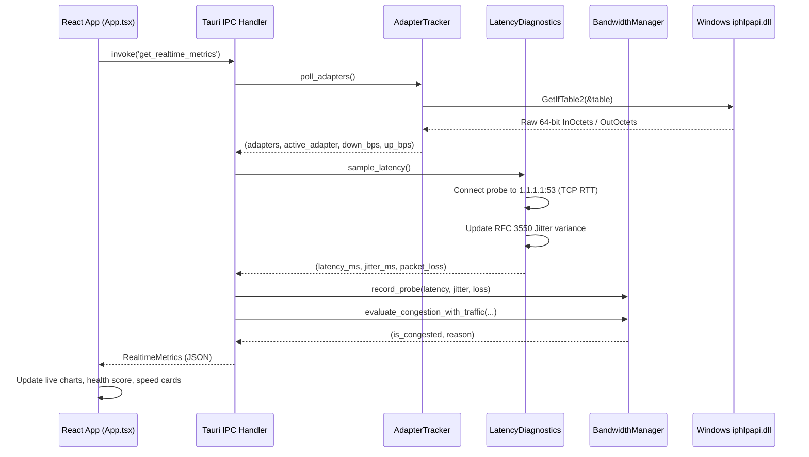

# 04 — System Architecture: Multi-Tier Design & Component Topology

---

## 1. Overall Architectural Philosophy

NetBoost implements a **hybrid layered and event-driven architecture** combining a zero-cost compiled native systems core (Rust) with a reactive, sandboxed presentation layer (React) and a decoupled browser extension (Chromium Manifest V3).

The architectural design prioritizes:
1. **Low Latency & High Pacing Accuracy**: The core telemetry, network analysis, and packet pacing loops execute in native machine code without garbage collection pauses.
2. **Crash Resilience**: Background operations (network probing, downloads, browser loopback server) run in isolated Tokio async tasks. If a network socket disconnects or an HTTP server fails, the failure is handled locally without crashing the desktop window.
3. **Zero External Cloud Telemetry**: All data processing, SQLite storage, packet inspection, and DNS benchmarking take place **100% locally** on the user's Windows machine.

---

## 2. Complete Architecture Diagram



---

## 3. Detailed Layer Breakdown

### Layer 1: Browser Extension Layer (`extension/`)
* **Role**: Observes download creation events across websites in Chromium browsers.
* **Component Responsibilities**:
  * `content.js`: Monitors user mouse interactions. If a user holds `Alt` while clicking a download link, it notifies the service worker to bypass NetBoost.
  * `background.js`: Intercepts `chrome.downloads.onCreated`. Checks file extensions (`.zip`, `.exe`, `.iso`, etc.) and MIME types (`application/octet-stream`). If eligible and NetBoost is running, it queries the local loopback server (`127.0.0.1:52140/intercept`).
  * `popup.js`: Allows users to toggle download capture on/off and shows desktop application connection status.

### Layer 2: Presentation Layer (`src/`)
* **Role**: Renders user interfaces and collects user commands.
* **Component Responsibilities**:
  * `App.tsx`: Central coordinator managing active tabs (`dashboard`, `applications`, `downloads`, `dns`, `benchmark`), running a 1000 ms telemetry polling interval, and catching global link clicks to launch in the external browser.
  * `QuickDownloadModal.tsx`: Listens via Tauri's event listener for `'netboost-download-detected'`. Displays a choice dialog allowing the user to select concurrency channels (4x, 6x, 8x, 12x) or decline and continue in the browser.
  * `tauriCommands.ts`: Exposes typed async wrappers around `invoke()`, ensuring frontend-backend type consistency.

### Layer 3: Tauri IPC & Loopback Communication Layer
* **Role**: Mediates communication between web contexts and native Rust threads.
* **Mechanisms**:
  1. **Tauri IPC (`invoke`)**: Used for desktop GUI requests (e.g. `get_realtime_metrics`, `start_download`). Messages are serialized into JSON and dispatched via Windows WebView2 native message channels.
  2. **Tauri Event Emitter (`emit`)**: Pushes asynchronous events from background Rust tasks to React (e.g. notifying the GUI when a new download has been intercepted).
  3. **Local Loopback HTTP Server (`127.0.0.1:52140`)**: Used exclusively by the browser extension to communicate with the desktop core over standard HTTP REST (`POST /intercept`, `GET /status`).

### Layer 4: Systems Core Layer (`src-tauri/src/`)
* **Role**: Core business logic, memory allocation, multi-threading, and hardware communication.
* **Key Components**:
  * **`AppState`**: Managed by Tauri using `app.manage()`. Holds `Arc<Mutex<...>>` references to all application services.
  * **`BandwidthManager`**: Maintains sliding-window latency samples, calculates median latency and jitter, applies 3-cycle hysteresis, and computes chunk pacing delays (0 ms to 45 ms).
  * **`DownloadEngine`**: Manages download tasks, probes remote server capabilities (`Range`, `Accept-Ranges`, `ETag`), pre-allocates `.part` files, and spawns parallel Tokio range workers.
  * **`StreamingDetector`**: Evaluates active TCP connections and I/O rates against known CDN hints, dedicated streaming binaries, and user-configured application rules.
  * **`Database`**: Wraps an embedded SQLite instance (`rusqlite`) for task state, benchmark runs, user rules, and DNS backup configurations.

### Layer 5: Windows OS Kernel & Hardware Layer
* **Role**: Hardware network interface cards, TCP/IP stack drivers, file systems, and registry.
* **APIs Used**:
  * `iphlpapi.dll`: Network interface hardware counters, extended TCP connection tables.
  * `kernel32.dll`: Process I/O counters, process querying, file manipulation.
  * `netsh.exe`: Adapter-level IPv4 DNS server assignment.
  * Windows Registry (`HKCU`): Startup persistence.

---

## 4. Component Interaction and Dependency Flow

NetBoost enforces a **unidirectional dependency rule** from high-level presentation down to the operating system:

```
[React GUI] ──> [Tauri IPC] ──> [Commands] ──> [AppState] ──> [Core Engines] ──> [Win32 / OS]
```

* UI components **never** access the file system, network sockets, or Windows APIs directly.
* Commands in `src-tauri/src/commands/` serve as boundary controllers; they validate input parameters, lock the required `AppState` mutexes, invoke engine methods, and return serialized results.
* Core engines (`DownloadEngine`, `BandwidthManager`, `StreamingDetector`) are decoupled from Tauri UI code and can be tested independently in unit/integration test harnesses (`tests/`).

---

## 5. Data Flow Architecture

### 5.1 Real-Time Telemetry Data Flow
Every 1000 milliseconds, the frontend telemetry polling loop executes:



---

## 6. Concurrency and Threading Architecture

NetBoost uses a hybrid threading architecture:

| Execution Context | Thread Model | Primary Purpose |
| :--- | :--- | :--- |
| **WebView2 UI Thread** | Single-threaded JavaScript event loop | Renders HTML/CSS, handles clicks, animates SVG charts. |
| **Tauri Main Thread** | Win32 message pump thread | Runs Windows window loop, system tray click handlers, window minimize/restore. |
| **Tokio Work-Stealing Pool** | Multi-threaded async green thread pool | Executes parallel HTTP Range download workers, pacing delays, file writes. |
| **Tokio Blocking Thread Pool** | `tokio::task::spawn_blocking` pool | Executes blocking network probes (e.g. repeated DNS UDP socket queries). |
| **Background Loopback Server** | Async task running on Tokio | Listens for HTTP requests on `127.0.0.1:52140` from the browser extension. |

### Thread Synchronization Rules
* **No Mutex held across `.await` points**: To prevent thread starvation and deadlocks, any lock acquired on `tasks` or `bandwidth_mgr` must be dropped before awaiting network I/O or timers.
* **Atomic state signaling**: Download worker tasks monitor an `Arc<AtomicBool>` for pause signals, allowing them to stop immediately without waiting for mutex locks.
* **Oneshot confirmation channels**: The local loopback interceptor uses `tokio::sync::oneshot` channels to suspend HTTP requests while awaiting user confirmation from the UI.

---

## 7. Security and Isolation Architecture

1. **Localhost Isolation**: The background REST server binds strictly to `127.0.0.1:52140`. It does NOT bind to `0.0.0.0` or external IP addresses, preventing external network machines from interacting with NetBoost.
2. **CORS Enforcement**: The interceptor handles HTTP `OPTIONS` preflight requests, accepting requests strictly from browser extensions.
3. **UAC Elevation Boundary**: NetBoost runs entirely in **user mode (`currentUser`)** without requiring Administrator privileges for monitoring, downloading, or pacing. When the user requests DNS tuning (`netsh`), NetBoost attempts standard execution first; if Windows requires elevation, it invokes a non-interactive PowerShell script with `-Verb RunAs` that prompts the native Windows UAC dialog cleanly.
4. **Zero Cloud Telemetry**: NetBoost communicates only with target download servers and public DNS anycast resolvers chosen by the user. No diagnostics, crash reports, or usage analytics are transmitted to third-party servers.

