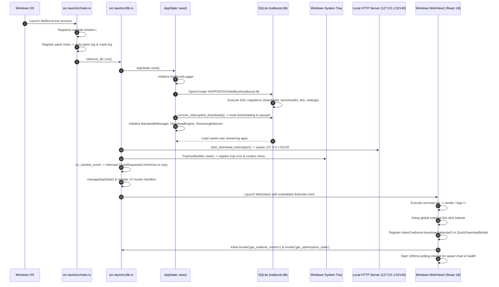

# 05 — Application Initialization: Startup Sequence & Lifecycle

---

## 1. Complete Startup Sequence Overview

The initialization of NetBoost is a coordinated multi-phase pipeline that starts at the native Windows Process Entry Point (`main.rs`), initializes the Rust systems state and embedded SQLite database, configures the Windows desktop shell (system tray, window event handlers, local loopback server), mounts the React 18 user interface, and initiates background telemetry polling loops.



---

## 2. Phase-by-Phase Technical Walkthrough

### Phase 1: Native Process Entry Point (`main.rs`)
Execution begins in `src-tauri/src/main.rs`:

```rust
// Prevents additional console window on Windows, DO NOT REMOVE!!
#![windows_subsystem = "windows"]

fn main() {
    std::panic::set_hook(Box::new(|info| {
        let msg = format!("CRASH PANIC: {}", info);
        let _ = std::fs::write("C:\\NetBoost\\panic.log", &msg);
        let appdata = std::env::var("APPDATA").unwrap_or_default();
        if !appdata.is_empty() {
            let _ = std::fs::write(format!("{}\\NetBoost\\logs\\crash.log", appdata), &msg);
        }
    }));

    netboost_lib::run();
}
```

1. **`#![windows_subsystem = "windows"]`**: A compiler directive instructing the MSVC linker (`link.exe`) to mark the Portable Executable (PE) header as a GUI subsystem application (`/SUBSYSTEM:WINDOWS`) instead of a console application (`/SUBSYSTEM:CONSOLE`). Without this directive, a black Command Prompt window would flash on the user's screen whenever NetBoost launches.
2. **Global Panic Hook (`std::panic::set_hook`)**: Catches unhandled Rust runtime panics (e.g. unexpected unwraps or out-of-bounds indexing). Rather than terminating silently, it logs the complete panic stack trace and error message directly to both `C:\NetBoost\panic.log` and `%APPDATA%\NetBoost\logs\crash.log`.
3. **Library Handoff**: Calls `netboost_lib::run()`, transferring execution to the shared library.

---

### Phase 2: Core State & Persistence Initialization (`AppState::new()`)
In `src-tauri/src/commands/network.rs`, `AppState::new()` initializes all singleton services:

1. **Logger Initialization**:
   `NetBoostLogger::init()` resolves the user's roaming directory (`%APPDATA%\NetBoost\logs`), creates the directory if missing, and appends an startup record: `[timestamp] [INFO] NetBoost networking engine initialized.`

2. **Database Connection & Schema Migration**:
   NetBoost resolves the path `%APPDATA%\NetBoost\netboost.db`. If `%APPDATA%` is missing, it falls back to a local `netboost.db` or an in-memory database. Upon connection, it invokes `init_schema()`, executing batch DDL statements to verify all tables and indexes exist:
   * `downloads` table + index `idx_downloads_created`
   * `benchmark_runs` table + index `idx_benchmarks_ts`
   * `user_streaming_apps` table
   * `dns_backups` table
   * `app_settings` table

3. **Startup Crash Recovery**:
   ```rust
   // Automatic startup crash recovery: pause interrupted downloads cleanly
   if let Ok(count) = db.recover_interrupted_downloads() {
       if count > 0 {
           logger.log("WARN", &format!("Startup crash recovery: reset {} interrupted tasks to paused state.", count));
       }
   }
   ```
   If the computer lost power or NetBoost was terminated forcefully during an active download, `recover_interrupted_downloads()` executes:
   ```sql
   UPDATE downloads SET status = 'paused' WHERE status = 'downloading'
   ```
   This ensures corrupted partial download tasks are never left in an inconsistent "downloading" state on boot. The user can simply click "Resume" to continue.

4. **Engine Instantiation**:
   * Instantiates `BandwidthManager` with a default baseline latency of 20 ms and 15-sample sliding window.
   * Instantiates `DownloadEngine`, loading existing tasks from SQLite into memory.
   * Instantiates `StreamingDetector`, querying `db.get_streaming_apps()` to load user-configured streaming executables into its lock-protected hash set.
   * Instantiates `BenchmarkRunner` and telemetry tracking wrappers.

---

### Phase 3: Desktop Shell & System Tray Setup (`lib.rs`)
In `src-tauri/src/lib.rs`, the Tauri builder configures desktop integration:

1. **Background Loopback Server**:
   ```rust
   downloads::interceptor::start_download_interceptor(app.handle().clone());
   ```
   Spawns an asynchronous Tokio task binding to `127.0.0.1:52140`. This server is online and ready before the user even opens their browser.

2. **Windows System Tray Registration**:
   Constructs a native Windows notification area (tray) icon with a context menu containing:
   * **Open NetBoost**: Unminimizes and brings the webview window to the front.
   * **Quit NetBoost**: Terminates the application cleanly (`app.exit(0)`).
   * **Left-Click Handler**: Clicking the glowing speedometer icon in the tray immediately restores and focuses the main window.

3. **Window Close Interception**:
   ```rust
   .on_window_event(|window, event| {
       if let tauri::WindowEvent::CloseRequested { api, .. } = event {
           api.prevent_close();
           let _ = window.hide();
       }
   })
   ```
   When the user clicks the top-right "X" button, NetBoost **does not terminate**. Instead, it intercepts the event via `api.prevent_close()` and hides the window. NetBoost continues running quietly in the system tray, maintaining active download pacing and media stream protection in the background.

4. **IPC Command Registration**:
   Registers all 22 command handlers with `invoke_handler(tauri::generate_handler![...])`.

---

### Phase 4: Frontend Webview Bootstrap (`index.html` & `main.tsx`)
1. The Microsoft Edge WebView2 runtime navigates to the compiled bundle at `dist/index.html`.
2. `index.html` loads `<div id="root"></div>` and executes `<script type="module" src="/src/main.tsx"></script>`.
3. `main.tsx` mounts the React application tree:
   ```typescript
   ReactDOM.createRoot(document.getElementById('root')!).render(
     <React.StrictMode>
       <App />
     </React.StrictMode>
   );
   ```

---

### Phase 5: Component Mount & Telemetry Polling (`App.tsx`)
Once mounted, `App.tsx` activates the application's runtime loops:

1. **Global Link Click Interceptor**:
   Registers a capturing click listener on `document`. Any clicked `<a href="http...">` is prevented from opening inside the desktop webview; instead, it is passed to `openExternalUrl()` which invokes Windows `rundll32.exe url.dll,FileProtocolHandler` to open the URL in the user's default browser (Chrome/Edge/Firefox).
2. **Download Detection Event Listener**:
   `QuickDownloadModal.tsx` registers `listen('netboost-download-detected')`. Whenever a download is captured by the loopback server, the modal receives the payload and renders immediately.
3. **Active Telemetry Loop**:
   Executes an initial poll followed by a `setInterval(poll, 1000)`:
   * Calls `getRealtimeMetrics()` to obtain current throughput rates, ping, jitter, and packet loss.
   * Calls `getOptimizationState()` to obtain active mode, congestion status, and pacing delays.
   * Appends metrics to `speedHistory` (retaining the most recent 60 seconds) to feed the live SVG throughput graph.

