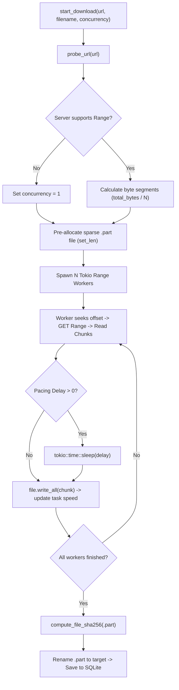

# 07 — Core Functionalities: Deep Architectural Mechanics

---

## 1. Feature Index

NetBoost implements ten core features:
1. **Hardware Interface Telemetry** (`iphlpapi.dll` `GetIfTable2`)
2. **Live Internet Diagnostics & RFC 3550 Jitter Algorithm**
3. **Algorithmic Network Health Evaluation** (0–100 Score & Letter Grades)
4. **Intelligent Media Stream Detection & Heuristics**
5. **Adaptive Bandwidth Coordination & Dynamic Chunk Pacing**
6. **Multi-Worker Parallel Download Acceleration**
7. **Chromium Browser Download Interception & Choice Channel**
8. **High-Precision DNS Benchmarking & Automated Windows Adapter Tuning**
9. **Controlled Network Load Benchmarking & Comparison Suite**
10. **System Tray, Windows Registry Startup & Crash Recovery**

---

## 2. Feature 1: Hardware Interface Telemetry

### Problem It Solves
Consumer operating systems often display stale, averaged network utilization. NetBoost requires raw, real-time byte counters directly from the network interface card (NIC) driver to calculate throughput deltas without estimation errors.

### Implementation Trace
1. **Entry Point**: `get_realtime_metrics` in `src-tauri/src/commands/network.rs`.
2. **Execution**:
   * Invokes `tracker.poll_adapters()` in `src-tauri/src/network/adapter.rs`.
   * Calls `query_interface_table()` in `src-tauri/src/windows/iphlpapi.rs`.
   * Directly invokes Win32 API `GetIfTable2(&mut table_ptr)`.
3. **Data Transformation & Delta Math**:
   ```rust
   let dt = now.duration_since(prev.timestamp).as_secs_f64();
   if dt > 0.05 {
       let d_in = raw.in_octets.saturating_sub(prev.in_octets);
       let d_out = raw.out_octets.saturating_sub(prev.out_octets);
       let down_bps = (d_in as f64) / dt;
       let up_bps = (d_out as f64) / dt;
   }
   ```
   * Compares the current 64-bit `InOctets` and `OutOctets` against the previous timestamp sample.
   * `saturating_sub` prevents underflow in the rare event of counter resets or adapter disconnects.
4. **Active Adapter Election**:
   NetBoost iterates through all adapters with `is_up = true` and `adapter_type != "loopback"`. The adapter with the highest negotiated PHY link speed (`speed_bps`) is elected as the active primary adapter.
5. **Output**: Transmitted to React via Tauri IPC, updating `NetworkOverview.tsx` and the live SVG chart.

---

## 3. Feature 2: Live Internet Diagnostics & RFC 3550 Jitter Engine

### Problem It Solves
Ping alone does not measure connection stability. Video streaming buffers degrade rapidly when packet arrival times fluctuate—a phenomenon known as **packet jitter**.

### Implementation Trace
1. **File**: `src-tauri/src/network/ping.rs` (`LatencyDiagnostics::sample_latency`).
2. **Measurement**:
   * Measures TCP connect round-trip time against high-reliability public resolvers: `1.1.1.1:53`, `8.8.8.8:53`, `9.9.9.9:53`.
   * Using port 53 (DNS) with a 1500 ms timeout ensures probes succeed across restrictive firewalls and enterprise proxies.
3. **RFC 3550 Interarrival Jitter Formula**:
   NetBoost implements the statistical jitter formula defined in **RFC 3550 Section 6.4.1 (RTP: A Transport Protocol for Real-Time Applications)**:
   $$D(i-1, i) = |R_i - R_{i-1}|$$
   $$J(i) = J(i-1) + \frac{D(i-1, i) - J(i-1)}{16}$$
   Where:
   * $R_i$ is the round-trip latency of the current sample.
   * $D(i-1, i)$ is the absolute difference between consecutive latency measurements.
   * The smoothing filter weight $\frac{1}{16}$ ($0.0625$) ensures that transient latency spikes do not produce erratic jitter readings while still adapting quickly to sustained route variance.
4. **Packet Loss Sliding Window**:
   Maintains a 20-probe boolean window (`loss_window: Vec<bool>`). If a socket connection times out or is rejected, `false` is appended. Packet loss percentage is calculated as:
   $$\text{Loss \%} = \frac{\text{Failed Probes}}{\text{Total Probes in Window}} \times 100$$

---

## 4. Feature 3: Algorithmic Network Health Evaluation

### Problem It Solves
End users do not intuitively understand raw millisecond numbers or jitter variance. NetBoost synthesizes these into an actionable **0 to 100 Health Score** and letter grades.

### Implementation Trace
1. **File**: `src-tauri/src/network/health.rs` (`evaluate_network_health`).
2. **Scoring Deductions**:
   * Starts with a baseline score of $100$.
   * **Latency Penalty**:
     * $\le 20\text{ ms}$: Grade `A+`, 0 penalty.
     * $21–40\text{ ms}$: Grade `A`, $-5$ points.
     * $41–80\text{ ms}$: Grade `B`, $-15$ points.
     * $81–150\text{ ms}$: Grade `C`, $-30$ points.
     * $> 150\text{ ms}$: Grade `D`, $-50$ points.
   * **Jitter Penalty**:
     * $\le 2.5\text{ ms}$: Grade `A+`, 0 penalty.
     * $2.6–6.0\text{ ms}$: Grade `A`, $-5$ points.
     * $6.1–12.0\text{ ms}$: Grade `B`, $-15$ points.
     * $> 12.0\text{ ms}$: Grade `C`, $-30$ points.
   * **Packet Loss Penalty**:
     * $\le 0.01\%$: Stability `100%`, 0 penalty.
     * $0.02–1.0\%$: Stability `99%`, $-10$ points.
     * $1.1–3.0\%$: Stability `95%`, $-25$ points.
     * $> 3.0\%$: Stability `Degraded`, $-50$ points.
3. **Clamping & Categorization**:
   The score is clamped: $\text{Score} \in [0, 100]$.
   * $\ge 90$: `"excellent"`
   * $75–89$: `"good"`
   * $55–74$: `"moderate"`
   * $< 55$: `"poor"`

---

## 5. Feature 4: Intelligent Media Stream Detection

### Problem It Solves
To protect video playback, NetBoost must know when streaming starts without requiring browser extensions on every streaming site or violating user privacy with deep packet inspection (DPI).

### Implementation Trace
1. **Files**:
   * `src-tauri/src/windows/iphlpapi.rs`: `ProcessNetworkMonitor::snapshot_processes_with_detector`.
   * `src-tauri/src/streaming/detector.rs`: `StreamingDetector::classify_process`.
2. **Socket Table Enumeration**:
   NetBoost queries `GetExtendedTcpTable` to retrieve every active socket on the system mapped to its PID.
3. **Process I/O Rate Tracking**:
   For each PID, it invokes `GetProcessIoCounters` to measure total bytes read and written. Calculating the derivative over elapsed time ($dt$) yields the instantaneous read transfer rate in bits/sec.
4. **Classification Heuristics**:
   * **Level 1 (User Rules)**: Checks user-configured names in `user_configured_apps`.
   * **Level 2 (Dedicated Players)**: Matches process name against `netflix.exe`, `spotify.exe`, `vlc.exe`, `stremio.exe`, `kodi.exe`, `plex.exe`, `discord.exe`, `zoom.exe`, `teams.exe`.
   * **Level 3 (Web Browsers)**: For `chrome.exe`, `msedge.exe`, `firefox.exe`, `brave.exe`:
     * Counts remote sockets terminating on port `:443` or `:8443`.
     * If $\ge 2$ HTTPS sockets exist **AND** sustained read rate exceeds $300\text{ Kbps}$ (or $\ge 3$ sockets with sustained read $> 1.5\text{ Mbps}$), NetBoost classifies the process as **active DASH/HLS media streaming** with `"high"` confidence.

---

## 6. Feature 5: Adaptive Bandwidth Coordination & Dynamic Chunk Pacing

### Problem It Solves
Standard download accelerators cause bufferbloat by flooding TCP receive windows. Hard-capping download speeds wastes available bandwidth when the connection is idle.

### Implementation Trace
1. **File**: `src-tauri/src/bandwidth/manager.rs` (`BandwidthManager`).
2. **Sliding Window Filtering**:
   Records latency, jitter, and packet loss samples into a 15-sample `VecDeque`. Median values are calculated to reject transient spikes.
3. **Hysteresis Counters**:
   * To prevent rapid oscillation, NetBoost requires **3 consecutive elevated probe cycles** before declaring congestion.
   * To declare recovery, it requires **5 consecutive calm probe cycles**.
4. **Adaptive Pacing Output**:
   When congestion or active streaming is confirmed in **Streaming Priority Mode**:
   * Injects an adaptive **20 ms to 45 ms read pacing delay** (`current_pacing_delay_ms`).
   * Scales worker concurrency down to **0.40x to 0.50x**.
   * Download workers query `mgr.get_pacing_delay_ms()` between chunk reads and invoke `tokio::time::sleep(...)`.
   * This throttles the download just enough to allow the local Wi-Fi router's packet buffer to drain, keeping ping flat at baseline levels while background downloads proceed.

---

## 7. Feature 6: Multi-Worker Parallel Segmented Download Acceleration

### Problem It Solves
Single-stream TCP transfers are severely throttled by latency and TCP window-scaling limits. Partitioning downloads into concurrent streams saturates full ISP link capacity.

### Implementation Trace


1. **URL Capabilities Probe**: Sends `Range: bytes=0-0` to inspect `Accept-Ranges`, `Content-Length`, `ETag`, and `Last-Modified`.
2. **Byte Partitioning**: If the file is $\ge 2\text{ MB}$ and supports ranges, it partitions the payload across $N$ workers (4 to 12):
   $$\text{Chunk Size} = \frac{\text{Total Bytes}}{N}$$
3. **Sparse File Pre-allocation**: Invokes `file.set_len(total_bytes)`. NTFS creates a sparse file instantly with zero post-download file merging overhead.
4. **Independent Workers**: Each worker runs an isolated async task, seeking directly to its assigned file offset and streaming data into the pre-allocated region.
5. **Self-Healing Reconnection**: If a server resets a TCP connection mid-stream, workers retry up to 5 times with exponential backoff, resuming exactly from the last written byte offset.
6. **Integrity Verification**: Computes SHA-256 hash across the completed file before renaming it to the final user path.

---

## 8. Feature 7: Chromium Browser Download Interception

### Problem It Solves
Traditional download managers either require copy-pasting URLs or install intrusive network filter drivers that break browser downloads if the manager is closed.

### Implementation Trace
1. **Extension Detection**: `extension/background.js` listens to `chrome.downloads.onCreated`.
2. **Bypass Detection**: Checks if the user held `Alt` during clicking (captured by `content.js`), in which case NetBoost bypasses interception.
3. **Local Loopback Bridge**: Posts download details to `http://127.0.0.1:52140/intercept`.
4. **Modal Presentation**: NetBoost brings its window forward and renders `QuickDownloadModal.tsx`.
5. **Non-Blocking Guarantee**:
   * If the user selects **Accelerate with NetBoost**, the loopback server returns `{"accelerate": true}` and Chrome cancels its native download.
   * If the user selects **Download in Browser** (or if 25 seconds elapse without a response), the server returns `{"accelerate": false}`, NetBoost hides to the tray, and Chrome proceeds with its native "Save As" flow without delay.

---

## 9. Feature 8: High-Precision DNS Benchmarking & Adapter Auto-Tuning

### Problem It Solves
ISP-provided DNS servers are often slow and suffer high Time To First Byte (TTFB). Changing DNS manually in Windows requires digging through Control Panel adapter properties.

### Implementation Trace
1. **RFC 1035 UDP Prober**:
   * In `src-tauri/src/dns/bench.rs`, NetBoost binds a raw `UdpSocket` on `0.0.0.0:0`.
   * Assembles a 12-byte DNS Type A query packet for test domains (`google.com`, `cloudflare.com`, `microsoft.com`, `wikipedia.org`, `amazon.com`).
   * Measures response round-trip time across Cloudflare (`1.1.1.1`), Google (`8.8.8.8`), Quad9 (`9.9.9.9`), OpenDNS (`208.67.222.222`), and the current system resolver.
2. **Automated Windows Configuration**:
   * In `src-tauri/src/dns/windows.rs`, NetBoost extracts current settings via `netsh interface ipv4 show dnsservers` and creates a permanent backup in SQLite (`dns_backups`).
   * Applies the chosen resolver:
     ```powershell
     netsh interface ipv4 set dnsservers name="Wi-Fi" static 1.1.1.1 primary
     netsh interface ipv4 add dnsservers name="Wi-Fi" 1.0.0.1 index=2
     ```
3. **One-Click Restoration**:
   Clicking "Restore Original DNS" reads the SQLite backup record and restores original static IPs or invokes `netsh ... source=dhcp`.

---

## 10. Feature 9: Controlled Network Load Benchmarking Suite

### Problem It Solves
Users want empirical proof that NetBoost mitigates bufferbloat and improves gaming/streaming latency during heavy downloads.

### Implementation Trace
1. **File**: `src-tauri/src/benchmark/engine.rs`.
2. **Phase 1 (Unloaded Baseline)**: Executes 10 consecutive probes to measure baseline idle latency and jitter.
3. **Phase 2 (Loaded Throughput)**: Initiates an active 5 MB HTTP download stream while simultaneously launching 15 parallel latency probes.
4. **Comparative Analysis**:
   Compares the current run against previous unoptimized runs stored in SQLite, calculating:
   $$\text{Bufferbloat Delta} = \text{Latency}_{\text{Loaded}} - \text{Latency}_{\text{Unloaded}}$$
   $$\text{Latency Improvement \%} = \frac{\text{Baseline Latency} - \text{Current Latency}}{\text{Baseline Latency}} \times 100$$
5. **Persistence**: Saves the complete benchmark record in SQLite (`benchmark_runs`).

---

## 11. Feature 10: System Tray & Windows Registry Startup

### Problem It Solves
Network optimization utilities must run continuously in the background without cluttering the Windows Taskbar.

### Implementation Trace
1. **System Tray**:
   Configured in `src-tauri/src/lib.rs` via `TrayIconBuilder`. Left-clicking the tray icon unhides and focuses the window. Closing the window minimizes to tray via `api.prevent_close()`.
2. **Windows Startup Registry**:
   In `src-tauri/src/commands/settings.rs`:
   * To enable auto-start, NetBoost executes `reg.exe` with `CREATE_NO_WINDOW`:
     ```powershell
     reg add HKCU\Software\Microsoft\Windows\CurrentVersion\Run /v NetBoost /t REG_SZ /d "C:\...\NetBoost.exe" /f
     ```
   * Runs in `HKCU` (Current User), requiring **zero UAC administrator elevation**.
3. **Crash Recovery**:
   On boot, `AppState::new()` executes `db.recover_interrupted_downloads()`, transitioning any task stuck in `downloading` status to `paused`.

