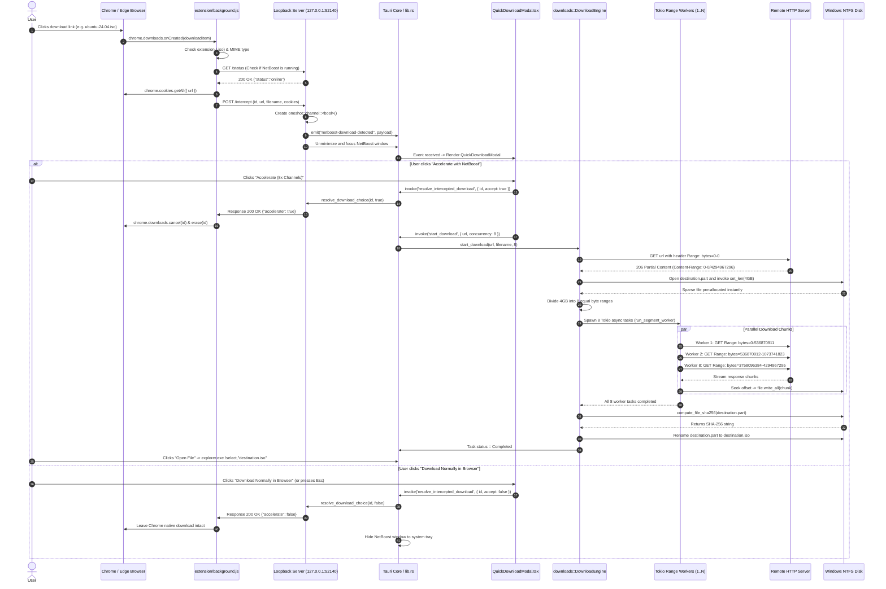
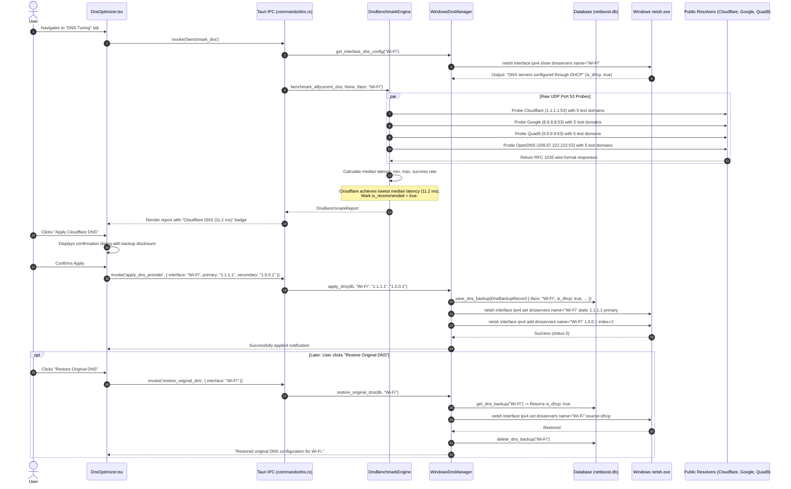
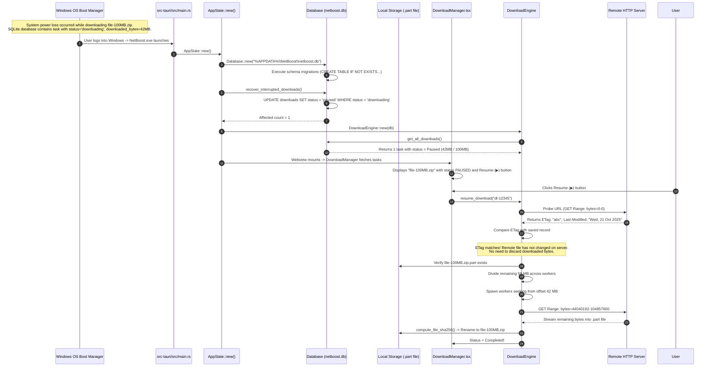

# 08 — End-to-End Execution Flows: Complete Sequence Traces

---

## 1. Flow A: Browser Download Interception & Multi-Worker Acceleration

This trace details the journey of a user clicking a file download link on a website until the accelerated file is verified on disk and opened in Windows Explorer.



---

## 2. Flow B: Dynamic Streaming Prioritization & Pacing under Load

This trace explains how NetBoost detects when a user begins watching YouTube or joins a Discord voice call during an active download, and dynamically paces chunk reads to eliminate bufferbloat without stopping the download.

```mermaid
sequenceDiagram
    autonumber
    actor User
    participant Worker as Download Worker Task
    participant Coord as BandwidthManager
    participant Monitor as ProcessNetworkMonitor
    participant Kernel as Windows Kernel (iphlpapi.dll)
    participant Diag as LatencyDiagnostics
    participant Router as Local Wi-Fi Router
    participant StreamApp as Chrome / YouTube (or Discord)

    Note over Worker: Background download running at 80 Mbps.<br/>Wi-Fi router queue fills; Ping rises from 18ms to 180ms.

    User->>StreamApp: Starts YouTube 4K video or enters Discord call
    StreamApp->>Kernel: Opens multiple TLS sockets on port 443

    loop Every 1000ms Telemetry Poll
        Monitor->>Kernel: GetExtendedTcpTable() & GetProcessIoCounters()
        Kernel-->>Monitor: Process socket tables & I/O byte rates
        Monitor->>Monitor: StreamingDetector: Chrome has 3 HTTPS sockets + read rate > 1.5 Mbps
        Monitor-->>Coord: active_streaming_sessions = 1

        Diag->>Router: TCP connect probe to 1.1.1.1:53
        Router-->>Diag: Ping spiked to 175 ms, Jitter = 19.4 ms
        Diag-->>Coord: (latency: 175ms, jitter: 19.4ms)

        Coord->>Coord: elevated probe detected (congestion_streak += 1)
        Note over Coord: Streak reaches 3 consecutive cycles.<br/>BandwidthManager transitions to CONGESTED!
        Coord->>Coord: Apply Streaming Policy:<br/>pacing_delay_ms = 45ms<br/>concurrency_factor = 0.40
    end

    loop Active Chunk Read Loop in Download Worker
        Worker->>Coord: get_pacing_delay_ms()
        Coord-->>Worker: Returns 45 ms
        Worker->>Worker: tokio::time::sleep(Duration::from_millis(45)).await
        Note over Worker,Router: Worker pauses reading from TCP socket.<br/>Router's packet buffer drains completely!
    end

    loop Next Telemetry Polls (Recovery Phase)
        Diag->>Router: TCP connect probe to 1.1.1.1:53
        Router-->>Diag: Ping drops to 22 ms, Jitter = 2.1 ms
        Coord->>Coord: recovery_streak reaches 5 cycles -> Set pacing_delay_ms = 30ms (Sustained Protection)
    end

    Note over StreamApp: YouTube 4K stream continues playback smoothly with zero buffering!
```

---

## 3. Flow C: DNS Optimization, Benchmarking & System Restoration

This trace details benchmarking public resolvers, backing up existing Windows network configuration, applying low-latency DNS servers, and restoring original settings.



---

## 4. Flow D: Application Crash Recovery & Task Resumption on Boot

This trace details how NetBoost recovers gracefully when the operating system loses power or terminates forcefully during active multi-worker downloading.



