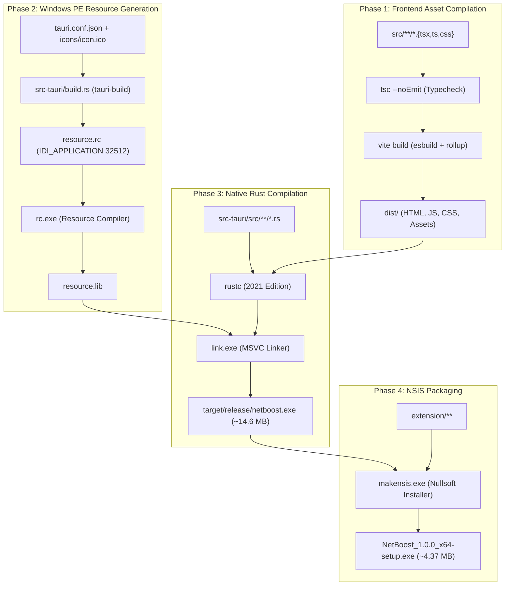

# 11 — Configuration, Build & Deployment Pipeline

---

## 1. Prerequisites & Environment Setup

Building NetBoost requires tools spanning both the Node.js and native C++/Rust compilation ecosystems on Windows 10 or 11:

### 1.1 Required Toolchains
1. **Node.js (v18.x or v20.x LTS) & npm**:
   * Provides the JavaScript runtime for Vite and TypeScript compilation.
   * Verify: `node -v` and `npm -v`.
2. **Rust & Cargo (v1.75+ Stable)**:
   * Toolchain target: `x86_64-pc-windows-msvc`.
   * Installed via [rustup.rs](https://rustup.rs/).
   * Verify: `rustc --version` and `cargo --version`.
3. **Visual Studio C++ Build Tools (2019 or 2022)**:
   * Required for the Microsoft C/C++ Optimizing Linker (`link.exe`), Windows Resource Compiler (`rc.exe`), and Windows SDK headers (`iphlpapi.h`, `windows.h`, `ws2def.h`).
   * Component workload: *"Desktop development with C++"*.
4. **NSIS (Nullsoft Scriptable Install System)**:
   * Downloaded automatically by Tauri CLI during bundling to build the Windows setup wizard.

---

## 2. Configuration Files Deep Dive

### 2.1 `package.json`
Controls the frontend compilation scripts and dependencies:
```json
{
  "name": "netboost",
  "version": "1.0.0",
  "type": "module",
  "scripts": {
    "dev": "vite",
    "build": "tsc && vite build",
    "preview": "vite preview",
    "tauri": "tauri"
  },
  "dependencies": {
    "@tauri-apps/api": "^2.2.0",
    "@tauri-apps/plugin-shell": "^2.2.0",
    "lucide-react": "^1.16.0",
    "react": "^18.3.1",
    "react-dom": "^18.3.1"
  },
  "devDependencies": {
    "@tauri-apps/cli": "^2.2.0",
    "@types/node": "^22.10.0",
    "@types/react": "^18.3.12",
    "@types/react-dom": "^18.3.1",
    "@vitejs/plugin-react": "^4.3.4",
    "autoprefixer": "^10.4.20",
    "postcss": "^8.4.49",
    "tailwindcss": "^3.4.16",
    "typescript": "^5.7.2",
    "vite": "^5.4.11"
  }
}
```
* `"type": "module"`: Enforces ECMAScript modules (ESM) syntax (`import`/`export`) across the project.
* `"build": "tsc && vite build"`: First runs the TypeScript type-checker (`tsc`) with `noEmit: true`. If and only if type verification passes without errors, Vite bundles the assets into `dist/`.

### 2.2 `src-tauri/Cargo.toml`
Controls native Rust compiler optimization and Windows dependencies:
```toml
[package]
name = "netboost"
version = "1.0.0"
description = "NetBoost – Intelligent Windows Network Optimization"
authors = ["NetBoost Team"]
edition = "2021"

[lib]
name = "netboost_lib"
crate-type = ["staticlib", "cdylib", "rlib"]

[build-dependencies]
tauri-build = { version = "2.7.4", features = [] }

[dependencies]
tauri = { version = "2.12.5", features = ["tray-icon"] }
serde = { version = "1.0", features = ["derive"] }
serde_json = "1.0"
tokio = { version = "1", features = ["full"] }
rusqlite = { version = "0.32", features = ["bundled"] }
reqwest = { version = "0.12", default-features = false, features = ["stream", "json", "rustls-tls"] }
chrono = { version = "0.4", features = ["serde"] }
sha2 = "0.10"
log = "0.4"
windows-sys = { version = "0.59", features = [
    "Win32_Foundation",
    "Win32_NetworkManagement_IpHelper",
    "Win32_NetworkManagement_Ndis",
    "Win32_Networking_WinSock",
    "Win32_System_Diagnostics_ToolHelp",
    "Win32_System_Threading",
    "Win32_System_ProcessStatus",
    "Win32_Security"
] }

[profile.dev]
incremental = false

[profile.release]
incremental = false
opt-level = 2
lto = false
```
* **`crate-type = ["staticlib", "cdylib", "rlib"]`**: Configures the crate so it can be compiled both as an executable and as a shared/static library for integration testing.
* **`[profile.release]`**:
  * `opt-level = 2`: Applies aggressive LLVM code optimizations for high networking throughput.
  * `lto = false`: Disables Link-Time Optimization (LTO) to avoid excessive MSVC build times and prevent out-of-memory errors on machines with limited RAM during linking.
  * `incremental = false`: Ensures clean, reproducible release compilation.

### 2.3 `src-tauri/tauri.conf.json`
Specifies window dimensions, security policies, and bundling targets:
```json
{
  "productName": "NetBoost",
  "version": "1.0.0",
  "identifier": "com.netboost.desktop",
  "build": {
    "frontendDist": "../dist",
    "beforeDevCommand": "npm run dev",
    "beforeBuildCommand": "npm run build"
  },
  "app": {
    "windows": [
      {
        "label": "main",
        "title": "NetBoost – Network Optimization Utility",
        "width": 1180,
        "height": 780,
        "minWidth": 960,
        "minHeight": 640,
        "resizable": true,
        "fullscreen": false,
        "center": true
      }
    ]
  },
  "bundle": {
    "active": true,
    "targets": ["nsis"],
    "resources": {
      "../extension": "extension"
    },
    "windows": {
      "nsis": {
        "installMode": "currentUser",
        "installerIcon": "icons/icon.ico"
      }
    }
  }
}
```
* **`"frontendDist": "../dist"`**: Tells Tauri where Vite outputs the production HTML/JS/CSS assets.
* **`"resources": { "../extension": "extension" }`**: Bundles the entire Chrome companion extension into the NSIS installer, allowing NetBoost's "Open Extension Folder" button to locate it reliably on end-user machines.
* **`"installMode": "currentUser"`**: Configures NSIS to install into `%LOCALAPPDATA%\Programs\NetBoost`. This enables end users to install and run NetBoost **without requiring Windows Administrator (UAC) elevation**.

### 2.4 `vite.config.ts`
```typescript
import { defineConfig } from 'vite';
import react from '@vitejs/plugin-react';

const host = process.env.TAURI_DEV_HOST;

export default defineConfig({
  plugins: [react()],
  clearScreen: false,
  server: {
    port: 1420,
    strictPort: true,
    host: host || false,
    hmr: host ? { protocol: 'ws', host, port: 1421 } : undefined,
    watch: {
      ignored: ['**/src-tauri/**'],
    },
  },
});
```
* Configures local development server on port 1420 with strict port locking.
* Ignores changes to `src-tauri/` to prevent Vite from reloading the frontend when Rust source files are edited.

---

## 3. Four-Phase Build Pipeline Architecture



---

## 4. How to Build: Step-by-Step Commands

### Target 1: Generate Complete Windows NSIS Setup Installer
```powershell
cd C:\NetBoost
npm install
npx tauri build --bundles nsis
```
* **Output Path**: `src-tauri/target/release/bundle/nsis/NetBoost_1.0.0_x64-setup.exe`
* **Size**: ~4.37 MB.
* **Installer Behavior**:
  1. Installs executable to `%LOCALAPPDATA%\Programs\NetBoost\NetBoost.exe`.
  2. Extracts companion browser extension to `%LOCALAPPDATA%\Programs\NetBoost\resources\extension`.
  3. Registers Start Menu and Desktop shortcuts.
  4. Indexes the application with the Windows Search service (`Win` -> type "NetBoost").
  5. Generates an uninstaller registered with Windows *Installed Apps*.

### Target 2: Generate Standalone Portable Binary (`NetBoost.exe`)
```powershell
cd C:\NetBoost
npm run build
cd src-tauri
cargo build --release
cd ..
```
* **Output Path**: `src-tauri/target/release/netboost.exe`
* **Size**: ~14.6 MB.
* **Usage**: Completely self-contained. Rename to `NetBoost.exe` and execute directly without installation.

### Target 3: Fast Debug Compilation (For Rapid Testing)
```powershell
npm run build
cd src-tauri
cargo build
cd ..
```
* **Output Path**: `src-tauri/target/debug/netboost.exe`

---

## 5. Compiler Cache & Disk Space Management

During Rust development, the `src-tauri/target/` directory accumulates intermediate compiler artifacts (`.rlib`, `.obj`, `.pdb`, incremental build databases), frequently growing to **9+ GB**.

To clean intermediate compiler caches without harming source code:
```powershell
cd C:\NetBoost\src-tauri
cargo clean
cd ..
```
* **Result**: Instantly frees ~9.6 GB of disk space.

---

## 6. Build Troubleshooting Reference

| Error Message | Root Cause | Solution |
| :--- | :--- | :--- |
| `Access is denied (os error 5)` | A running instance of `NetBoost.exe` is active in Windows (often minimized in the system tray near the clock), locking the binary. | Run `Stop-Process -Name "*netboost*" -Force` in PowerShell. |
| `Paging file too small (os error 1455)` | Compiling multiple heavy integration test suites in parallel with MSVC on systems with limited commit charge. | Compile tests sequentially: `cargo test -p netboost -- --test-threads=1`. |
| Windows Explorer displays old icon | Windows shell caches icons in `%LOCALAPPDATA%\IconCache.db` based on file path. | Force Windows shell to refresh icon cache: run `ie4uinit.exe -show` in CMD. |

