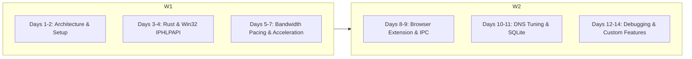

# 15 — Complete Developer Learning Roadmap: Zero to Codebase Mastery

---

## 1. Roadmap Overview & Curriculum Objectives

This 14-day technical training curriculum is engineered for a software engineer joining the NetBoost project. By following this day-by-day plan, you will progress from understanding high-level concepts to navigating the code, debugging issues, modifying functionality, and shipping production releases.



---

## 2. Week 1: Core Architecture, Telemetry, and Pacing

### Day 1: System Overview & Local Environment Bootstrap
* **Goals**: Understand the bufferbloat problem; set up development toolchains on Windows.
* **Reading**: Read [00-project-overview.md](file:///c:/NetBoost/docs/codebase-deep-dive/00-project-overview.md) and [01-complete-repository-structure.md](file:///c:/NetBoost/docs/codebase-deep-dive/01-complete-repository-structure.md).
* **Hands-On Tasks**:
  1. Verify toolchains: `rustc --version`, `cargo --version`, `node -v`, `npm -v`.
  2. Install dependencies: `npm install` in repository root.
  3. Run the development environment:
     ```powershell
     npm run dev
     npm run tauri dev
     ```
  4. Verify the NetBoost desktop window launches, displays live speed counters, and docks to the Windows system tray.

---

### Day 2: Multi-Language Fundamentals & Architecture Topology
* **Goals**: Master the language boundaries (Rust vs. TypeScript) and the Tauri IPC bridge.
* **Reading**: Read [02-programming-language-fundamentals.md](file:///c:/NetBoost/docs/codebase-deep-dive/02-programming-language-fundamentals.md) and [04-system-architecture.md](file:///c:/NetBoost/docs/codebase-deep-dive/04-system-architecture.md).
* **Hands-On Tasks**:
  1. Inspect `src-tauri/src/commands/network.rs` and trace how `get_realtime_metrics` returns JSON.
  2. Inspect `src/services/tauriCommands.ts` and locate the TypeScript wrapper invoking `get_realtime_metrics`.
  3. Open Developer Tools in the desktop window (F12) and inspect the live IPC responses in the console.

---

### Day 3: Native Windows Kernel Telemetry (`iphlpapi.dll`)
* **Goals**: Understand how NetBoost queries Windows hardware adapters and TCP sockets without external drivers.
* **Reading**: Read [06-file-by-file-code-explanation.md](file:///c:/NetBoost/docs/codebase-deep-dive/06-file-by-file-code-explanation.md) (Section: `windows/iphlpapi.rs`).
* **Hands-On Tasks**:
  1. Open `src-tauri/src/windows/iphlpapi.rs`. Trace `query_interface_table()` and find `GetIfTable2`.
  2. Locate `query_extended_tcp_table()` and understand how `TCP_TABLE_OWNER_PID_ALL` maps sockets to owner PIDs.
  3. Run the unit test: `cargo test --test test_network`.

---

### Day 4: Internet Diagnostics & RFC 3550 Jitter Mechanics
* **Goals**: Learn how packet jitter and ping variance are measured using TCP connect probes.
* **Reading**: Read [07-core-functionalities.md](file:///c:/NetBoost/docs/codebase-deep-dive/07-core-functionalities.md) (Features 1, 2, and 3).
* **Hands-On Tasks**:
  1. Open `src-tauri/src/network/ping.rs`. Trace the RFC 3550 formula:
     `self.jitter_ms = self.jitter_ms + (d - self.jitter_ms) / 16.0;`
  2. Inspect `src-tauri/src/network/health.rs`. Review how letter grades and penalties calculate the 0–100 score.
  3. Add a temporary `println!` in `sample_latency` and run `cargo test --test test_network -- --nocapture` to observe live RTT values.

---

### Day 5: Dynamic Bandwidth Coordination & Congestion Hysteresis
* **Goals**: Understand how NetBoost prevents router queue collapse through sliding-window medians and streak counters.
* **Reading**: Read [07-core-functionalities.md](file:///c:/NetBoost/docs/codebase-deep-dive/07-core-functionalities.md) (Feature 5) and `src-tauri/src/bandwidth/manager.rs`.
* **Hands-On Tasks**:
  1. Open `src-tauri/src/bandwidth/manager.rs`.
  2. Trace `evaluate_congestion_with_traffic(...)`:
     * Note how 3 consecutive elevated probes transition `is_congested` to `true`.
     * Note how 5 consecutive calm probes transition `is_congested` to `false`.
  3. Run integration tests: `cargo test --test test_bandwidth_coordinator`.

---

### Day 6: Media Stream Detection & Heuristics
* **Goals**: Learn how NetBoost identifies YouTube, Netflix, Discord, and Zoom sessions in real time.
* **Reading**: Read `src-tauri/src/streaming/detector.rs`.
* **Hands-On Tasks**:
  1. Trace `classify_process(...)`. Notice how it checks user overrides first, then dedicated streaming binaries, then browser HTTPS socket counts ($:443$) and sustained I/O read rates ($> 300\text{ Kbps}$).
  2. Run integration tests: `cargo test --test test_streaming_heuristics`.
  3. Launch NetBoost, start a YouTube video in Chrome, navigate to the **Applications** tab, and observe Chrome being tagged with a purple "STREAMING" badge.

---

### Day 7: Multi-Worker Download Acceleration & Sparse Files
* **Goals**: Master parallel HTTP Range downloading, sparse file pre-allocation, and cryptographic verification.
* **Reading**: Read `src-tauri/src/downloads/engine.rs` and [08-end-to-end-execution-flows.md](file:///c:/NetBoost/docs/codebase-deep-dive/08-end-to-end-execution-flows.md) (Flow A).
* **Hands-On Tasks**:
  1. Open `src-tauri/src/downloads/engine.rs`.
  2. Trace `probe_url(...)`: observe how it sends `Range: bytes=0-0` and extracts `Content-Range`.
  3. Locate `file.set_len(total_bytes)` and understand why NTFS sparse files eliminate post-download file stitching.
  4. Run integration tests: `cargo test --test test_download_engine`.

---

## 3. Week 2: Browser Extension, DNS Tuning, Debugging, and Extension

### Day 8: Chromium Companion Extension & Local REST Bridge
* **Goals**: Master Manifest V3 service workers, download interception, and the local loopback bridge.
* **Reading**: Read `extension/background.js` and `src-tauri/src/downloads/interceptor.rs`.
* **Hands-On Tasks**:
  1. Open `src-tauri/src/downloads/interceptor.rs`. Trace how `run_interceptor_server` listens on `127.0.0.1:52140`.
  2. In `extension/background.js`, locate `chrome.downloads.onCreated` and observe how it forwards download metadata via `fetch(NETBOOST_IPC_URL)`.
  3. Install the extension in Chrome: navigate to `chrome://extensions`, enable Developer mode, click "Load unpacked", and select `C:\NetBoost\extension`.

---

### Day 9: The Interactive Choice Channel (`QuickDownloadModal`)
* **Goals**: Understand how NetBoost brings its window forward and yields back to the browser on cancellation.
* **Reading**: Read `src/components/Downloads/QuickDownloadModal.tsx` and [10-api-and-communication.md](file:///c:/NetBoost/docs/codebase-deep-dive/10-api-and-communication.md).
* **Hands-On Tasks**:
  1. Trace how `QuickDownloadModal` listens to `listen('netboost-download-detected')`.
  2. Trace `resolve_intercepted_download`:
     * `accept: true` -> cancels Chrome download and launches NetBoost workers.
     * `accept: false` -> resumes Chrome native download and hides NetBoost to tray.
  3. Test with a real download: click any download link in Chrome and observe the modal popping up.

---

### Day 10: DNS Benchmarking & `netsh` Automation
* **Goals**: Understand binary UDP query construction and Windows network adapter tuning.
* **Reading**: Read `src-tauri/src/dns/bench.rs` and `src-tauri/src/dns/windows.rs`.
* **Hands-On Tasks**:
  1. In `dns/bench.rs`, inspect `build_dns_query`. Understand how domain strings are encoded into RFC 1035 wire-format bytes.
  2. In `dns/windows.rs`, trace `backup_dns_if_needed`, `apply_dns`, and `restore_original_dns`.
  3. Run integration tests: `cargo test --test test_dns_optimizer`.

---

### Day 11: Embedded SQLite Persistence & Crash Recovery
* **Goals**: Master database schema migrations, idempotent UPSERT operations, and boot crash recovery.
* **Reading**: Read [09-database-and-data-management.md](file:///c:/NetBoost/docs/codebase-deep-dive/09-database-and-data-management.md) and `src-tauri/src/storage/db.rs`.
* **Hands-On Tasks**:
  1. Inspect `recover_interrupted_downloads()`: observe how tasks in `downloading` status are reset to `paused`.
  2. Run integration tests: `cargo test --test test_production_persistence`.
  3. Open `%APPDATA%\NetBoost\netboost.db` in an SQLite viewer to inspect saved records.

---

### Day 12: Production Build Pipeline & NSIS Bundling
* **Goals**: Master release executable compilation, resource compiling, and NSIS installer generation.
* **Reading**: Read [11-configuration-build-and-deployment.md](file:///c:/NetBoost/docs/codebase-deep-dive/11-configuration-build-and-deployment.md) and `BUILD_PROCESS.md`.
* **Hands-On Tasks**:
  1. Run production build:
     ```powershell
     npx tauri build --bundles nsis
     ```
  2. Verify output installer in `src-tauri/target/release/bundle/nsis/`.
  3. Test installing `NetBoost_1.0.0_x64-setup.exe` on your machine. Verify it registers with Windows Search (`Win` key -> "NetBoost") and creates an uninstaller in Windows Settings.

---

### Day 13: Debugging Practical Scenarios
* **Goals**: Learn how to diagnose and resolve common operational errors.
* **Reading**: Read [13-testing-and-debugging.md](file:///c:/NetBoost/docs/codebase-deep-dive/13-testing-and-debugging.md).
* **Hands-On Tasks**:
  1. Simulate an interrupted download by disconnecting Wi-Fi mid-transfer. Observe self-healing worker reconnect logs in `%APPDATA%\NetBoost\logs\netboost.log`.
  2. Inspect the global panic hook in `src-tauri/src/main.rs`.
  3. Test running tests sequentially: `cargo test -p netboost -- --test-threads=1`.

---

### Day 14: Independence Capstone: Adding a Custom Feature
* **Goals**: Independently modify and extend the NetBoost codebase.
* **Practical Assignment**:
  1. Add a new public DNS provider (e.g. NextDNS `45.90.28.0`) to the benchmark list in `src-tauri/src/dns/bench.rs`.
  2. Rebuild the frontend (`npm run build`) and compile the backend (`cargo build`).
  3. Launch NetBoost, navigate to **DNS Tuning**, and verify NextDNS appears in the benchmark table with calculated latency.
  4. Explain the end-to-end architecture to a fellow engineer using the diagrams in this documentation suite!

