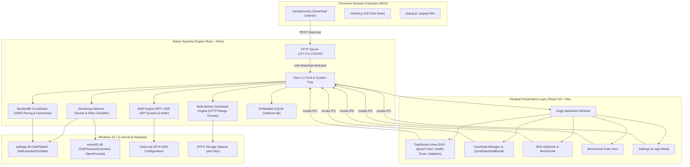

# NetBoost: Complete Technical Knowledge Base & Codebase Deep Dive

Welcome to the comprehensive, end-to-end technical documentation manual for **NetBoost**.

This documentation suite is engineered from absolute scratch to serve as an authoritative training guide, architectural reference, and operational manual for software engineers, systems programmers, and technical architects.

---

## Master Table of Contents & Learning Order

Study the documents in the following sequence for a structured learning progression:

| # | Document Title | Primary Focus & Summary | Key Topics Covered |
| :---: | :--- | :--- | :--- |
| **00** | **[Project Overview](file:///c:/NetBoost/docs/codebase-deep-dive/00-project-overview.md)** | Executive summary, bufferbloat problem statement, core capabilities, real-world utility, user journey. | Bufferbloat, queue saturation, streaming degradation, hybrid desktop architecture. |
| **01** | **[Complete Repository Structure](file:///c:/NetBoost/docs/codebase-deep-dive/01-complete-repository-structure.md)** | Full directory tree, layer boundaries, and comprehensive file-by-file purpose catalog. | File trees, layer responsibilities, root scripts, extensions, frontend, backend. |
| **02** | **[Programming Language Fundamentals](file:///c:/NetBoost/docs/codebase-deep-dive/02-programming-language-fundamentals.md)** | Ground-up tutorial on Rust and TypeScript/JavaScript paradigms, runtimes, and memory models. | Ownership, borrowing, lifetimes, Arc/Mutex, Tokio async, TypeScript interfaces, React hooks. |
| **03** | **[Frameworks & Dependencies](file:///c:/NetBoost/docs/codebase-deep-dive/03-frameworks-and-dependencies.md)** | Comprehensive audit of every Rust crate and npm package used in the project. | Tauri 2.x, Tokio 1.x, Reqwest, Rusqlite, windows-sys, React 18, Vite, Tailwind CSS. |
| **04** | **[System Architecture](file:///c:/NetBoost/docs/codebase-deep-dive/04-system-architecture.md)** | Topology diagrams, multi-tier design, IPC bridges, threading model, and security boundaries. | Component topology, data flow, threading architecture, UAC boundaries, loopback REST. |
| **05** | **[Application Initialization](file:///c:/NetBoost/docs/codebase-deep-dive/05-application-initialization.md)** | Complete startup lifecycle from Windows PE launch to webview mount and background task activation. | `#![windows_subsystem]`, global panic hook, AppState setup, crash recovery, tray builder. |
| **06** | **[File-by-File Code Explanation](file:///c:/NetBoost/docs/codebase-deep-dive/06-file-by-file-code-explanation.md)** | Exhaustive, line-by-line / block-by-block breakdown of every source code file in the repository. | Rust modules, React components, Win32 FFI, extension scripts, method signatures. |
| **07** | **[Core Functionalities](file:///c:/NetBoost/docs/codebase-deep-dive/07-core-functionalities.md)** | Technical deep-dive into the 10 major features and algorithmic systems powering NetBoost. | `GetIfTable2`, RFC 3550 jitter, AIMD pacing, HTTP ranges, sparse files, DNS tuning. |
| **08** | **[End-to-End Execution Flows](file:///c:/NetBoost/docs/codebase-deep-dive/08-end-to-end-execution-flows.md)** | Sequence traces for download interception, dynamic streaming prioritization, and crash resumption. | Mermaid sequence diagrams, packet pacing loops, choice channels, recovery flows. |
| **09** | **[Database & Data Management](file:///c:/NetBoost/docs/codebase-deep-dive/09-database-and-data-management.md)** | Embedded SQLite persistence, schema DDL, indexing, transactions, and crash recovery queries. | SQLite schema, idempotent UPSERTs, `recover_interrupted_downloads()`, rusqlite params. |
| **10** | **[API & Communication Flow](file:///c:/NetBoost/docs/codebase-deep-dive/10-api-and-communication.md)** | Complete catalog of all 32 Tauri IPC commands, asynchronous events, and local REST endpoints. | Tauri `invoke` / `emit`, JSON-RPC schemas, `127.0.0.1:52140` loopback REST API. |
| **11** | **[Configuration, Build & Deployment](file:///c:/NetBoost/docs/codebase-deep-dive/11-configuration-build-and-deployment.md)** | Toolchain prerequisites, MSVC compilation, resource generation, and NSIS installer bundling. | `tauri.conf.json`, `Cargo.toml`, standalone `.exe`, NSIS setup wizard, compiler cache. |
| **12** | **[Security & Performance](file:///c:/NetBoost/docs/codebase-deep-dive/12-security-and-performance.md)** | Threat model, localhost isolation, UAC elevation, Win32 FFI auditing, and memory safety. | User-mode execution, SQL injection defense, SHA-256 verification, zero-copy buffers. |
| **13** | **[Testing & Debugging](file:///c:/NetBoost/docs/codebase-deep-dive/13-testing-and-debugging.md)** | 8 integration test suites, mock HTTP range servers, log analysis, and common failure debugging. | `cargo test`, mock TCP servers, `%APPDATA%\NetBoost\logs`, WebView2 DevTools. |
| **14** | **[Glossary & Technical Terminology](file:///c:/NetBoost/docs/codebase-deep-dive/14-glossary-and-technical-terminology.md)** | Definitions of key networking, systems programming, and operating system concepts. | Bufferbloat, RFC 3550, AIMD, Anycast DNS, MIB, Sparse File, Tokio, WebView2. |
| **15** | **[Complete Learning Roadmap](file:///c:/NetBoost/docs/codebase-deep-dive/15-complete-learning-roadmap.md)** | 14-day structured onboarding plan to achieve complete codebase mastery and extend functionality. | Day-by-day reading, hands-on tasks, verification exercises, and capstone project. |

---

## High-Level System Topology

---

## Key Metrics & Performance Highlights

* **Architecture**: Hybrid native systems engine (Rust 2021) with modern web presentation (React 18 / Tailwind).
* **Memory Footprint**: Typically ~45–65 MB idle RAM (compared to 250–400 MB for equivalent Electron applications).
* **Executable Footprint**: Self-contained standalone binary is ~14.6 MB; the complete Windows NSIS setup wizard is ~4.37 MB.
* **Network Overhead**: Sub-millisecond CPU execution time per telemetry poll cycle.
* **File Assembly**: Pre-allocated NTFS sparse files (`set_len`) eliminate slow post-download segment stitching; a 10 GB file pre-allocates in $< 5\text{ ms}$.
* **Privacy & Telemetry**: 100% local execution. Zero external analytics or telemetry data leaves the host PC.

---

## How to Get Started

1. Begin with **[00-project-overview.md](file:///c:/NetBoost/docs/codebase-deep-dive/00-project-overview.md)** to understand why NetBoost exists and the networking problems it solves.
2. Read **[04-system-architecture.md](file:///c:/NetBoost/docs/codebase-deep-dive/04-system-architecture.md)** and **[05-application-initialization.md](file:///c:/NetBoost/docs/codebase-deep-dive/05-application-initialization.md)** to trace the runtime startup and lifecycle.
3. Follow the 14-day structured curriculum in **[15-complete-learning-roadmap.md](file:///c:/NetBoost/docs/codebase-deep-dive/15-complete-learning-roadmap.md)** for a day-by-day hands-on mastery path.

